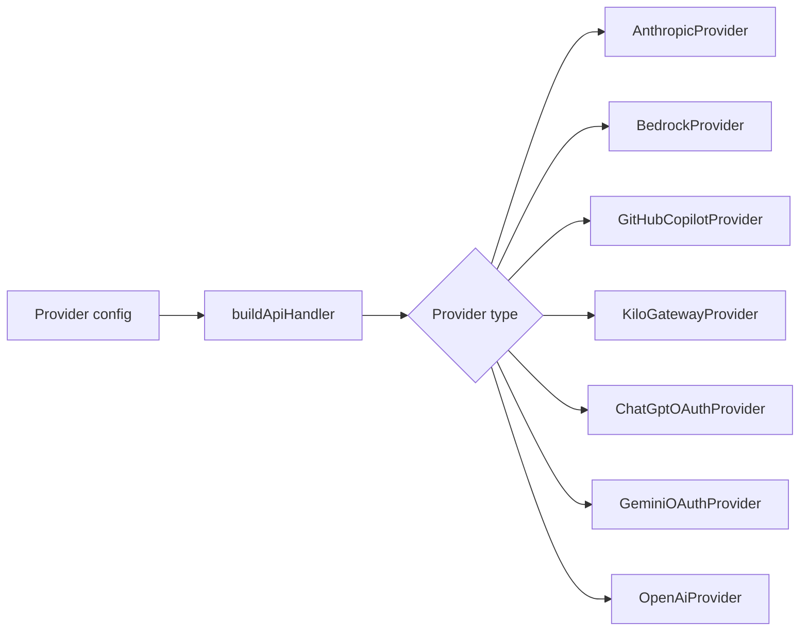

# Provider auth

Vault Operator supports these providers: Anthropic, OpenAI, Google Gemini (API key or OAuth), AWS Bedrock, OpenRouter, Azure, GitHub Copilot, ChatGPT (OAuth), Kilo Gateway, Ollama, LM Studio, and custom OpenAI-compatible endpoints. Each provider authenticates differently, but the agent talks to a single `ApiHandler` interface.

Since v2.11 the setup is provider-only: you configure a provider once, click **Refresh**, and the plugin discovers the available models and classifies them into three tiers (Budget / Main / Frontier) via `ModelTierClassifier`. The settings shape is `providerConfigs[]` (one row per provider with the discovered models attached), not the older `activeModels[]` (one row per model). See [Advisor pattern](./advisor-pattern) for how the tiers feed into the chat loop.

## The factory

The `buildApiHandler` factory (`src/api/index.ts`) takes a provider configuration and returns the right implementation. Anthropic, AWS Bedrock, GitHub Copilot, Kilo Gateway, ChatGPT-OAuth, and Gemini OAuth each have dedicated classes for their authentication or native wire formats. OpenAI, Google Gemini with an API key, Azure, OpenRouter, Ollama, LM Studio, and custom endpoints go through `OpenAiProvider`, since they speak the OpenAI API format.

The factory uses an exhaustive switch. Add a new provider type to the union and TypeScript forces you to handle it.

## Standard auth

Most providers accept an API key stored in settings. Each adapter sends it using the authentication headers required by that provider. Base URLs and header formats vary between providers.

Ollama and LM Studio are local providers that run on your machine and don't need an API key. The `OpenAiProvider` makes the key optional when the base URL points to localhost. Provider adapters use Obsidian's `requestUrl` for suitable non-streaming calls and the existing Node HTTP transport for streaming and cancellable requests.

## Google Gemini authentication

**Google Gemini** keeps the existing API-key setup. **Google Gemini (OAuth)**
adds a separate connection using your own Google Cloud project and Desktop
OAuth client. API quota and billing belong to that project; this connection
does not provide Gemini app or CLI subscription quota.

1. Follow Google's [OAuth setup](https://ai.google.dev/gemini-api/docs/oauth):
   enable the Generative Language API, configure consent and create a
   **Desktop app** client. A testing project must include your Google account
   among its test users.
2. Add **Google Gemini (OAuth)** under Providers. Enter the desktop client ID,
   its client secret if supplied, and the Google Cloud project ID for quota.
   Save the provider, then click **Sign in**.
3. Complete consent in your system browser. Obsidian receives the result over
   a temporary loopback callback and refreshes the model list. Choose your
   tiers and use **Test connection**.
4. For embeddings, add a model in Embeddings, choose **Google Gemini (OAuth)**,
   select the signed-in provider, fetch its embedding models and test one.

Desktop Obsidian and an available system keychain are required. The client
secret and refresh token use the existing encrypted provider storage; the
access token remains in memory. Closing the setup modal cancels an unfinished
login. Changing the client or quota project clears the old authorization and
model catalog. Signing out removes the local refresh token; Google account
permissions can also be revoked from your Google account.

OAuth inference uses the native Gemini REST API for streaming, tool calls,
images and embeddings. It preserves model- and account-scoped thought
signatures across tool rounds. Existing API-key connections retain their
OpenAI-compatible transport. Neither path imports Gemini CLI credentials.
See the [Google desktop OAuth protocol](https://developers.google.com/identity/protocols/oauth2/native-app)
for client and consent requirements.

## GitHub Copilot: three-stage token chain

GitHub Copilot authentication takes three stages, handled by `GitHubCopilotAuthService` (`src/core/security/GitHubCopilotAuthService.ts`).

First, the device code flow. The service requests a device code from GitHub, then shows you a URL and a short code. You open the URL in a browser, enter the code, and authorize the application. The service polls until authorization completes.

Second, the access token. GitHub returns a long-lived access token (valid ~30 days), which is stored securely and used to obtain short-lived Copilot tokens.

Third, the Copilot token. The access token is exchanged for a Copilot-specific token (valid ~1 hour) that gets sent with each API request. On expiry, the service refreshes it automatically using the access token.

A custom fetch wrapper (`getCopilotFetch()`) is injected into the OpenAI SDK for streaming chat completions because the SDK's built-in fetch doesn't handle Copilot's token format. The wrapper also handles token expiry: if a request fails with a 401, it triggers a refresh and retries.

For **GitHub Enterprise Cloud**, set **GitHub Enterprise Cloud host** to your tenant, for example `your-company.ghe.com`, before signing in. Both the provider dialog and model onboarding offer this field. Leave it empty for github.com. Sign out before changing hosts; credentials and discovered model metadata belong to one account at a time. A custom OAuth client ID can be supplied separately.

Vault Operator uses the API address returned with the Copilot token for both model discovery and inference. It persists that address across restarts and checks it before attaching a token. Existing github.com accounts continue to work. Self-hosted GitHub Enterprise Server is not a Copilot authentication host; sign in through the github.com or GHE.com account that holds your Copilot subscription. See [GitHub's Enterprise Server guidance](https://docs.github.com/en/enterprise-server@3.22/copilot/copilot-on-ghes/about-copilot-on-ghes).

## ChatGPT (OAuth): PKCE loopback flow

`ChatGptOAuthService` (`src/core/auth/ChatGptOAuthService.ts`) runs the PKCE loopback flow used by the Codex CLI. The plugin opens a short-lived localhost callback server, generates a code verifier and challenge, and points the browser at `auth.openai.com`. After approval the browser redirects to the callback. The plugin exchanges the code for an access token and a refresh token, then closes the callback server.

Requests then route to `chatgpt.com/backend-api/codex/responses` (the Codex Responses API) instead of the public `api.openai.com` `/chat/completions` endpoint. The GPT-5 family models on that endpoint require a `reasoning` block in every request body; the plugin resolves the user's configured `reasoningEffort` to one of `minimal | low | medium | high` via `resolveGptEffort()` and sends `reasoning: { effort, summary: 'auto' }`. The default floor is `low`, the narrowest level accepted by both `gpt-5` and the stricter Codex variants.

Refresh tokens auto-renew before expiry. Tokens are stored encrypted via `SafeStorageService`.

ChatGPT-OAuth bills against your existing Plus or Pro subscription, not a per-token API key. The plugin still tracks the equivalent API cost for transparency.

## Bedrock: SigV4 with optional session token

Bedrock authenticates via AWS SigV4 with an access key ID, secret access key, and optionally a session token for SSO or STS-issued credentials. The provider class signs every request locally; no SDK roundtrip needed. Cross-region inference profiles (model IDs prefixed with `eu.` or `us.`) route requests across all regions in that geography for higher availability. The `eu.*` profiles keep data inside the EU.

For Anthropic models the wire format is the Anthropic Messages API plus a `cachePoint` extension for prompt caching, handled by `BedrockProvider`. For Mistral and Amazon Nova the wire format is the Bedrock Invoke API.

## Google Gemini: API key

Gemini uses simple API-key auth against Google's OpenAI-compatible endpoint at `generativelanguage.googleapis.com/v1beta/openai`, so requests flow through `OpenAiProvider` with no translation layer. Free-tier rate limits apply.

## Kilo Gateway: device auth + manual token

The `KiloAuthService` (`src/core/security/KiloAuthService.ts`) supports two auth modes. The device authorization flow works like GitHub Copilot: you get a code, authorize in a browser, and the service polls until complete. Alternatively, you paste an API token directly for simpler setups.

Both modes produce the same session state. The service stores user profile information and provider defaults (available models, rate limits) retrieved from the gateway API at `https://api.kilo.ai/api`.

## Encrypted storage

On desktop, `SafeStorageService` (`src/core/security/SafeStorageService.ts`) uses Electron's `safeStorage` API to encrypt credentials before storing them. That in turn uses the operating system's keychain (Keychain on macOS, Credential Manager on Windows, libsecret on Linux).

The service loads Electron via dynamic `require('electron')`, one of the few places where `require()` is allowed instead of ES imports, because Electron can only be loaded dynamically in the renderer process.

Since v2.11.0 every credential field on `providerConfigs[]` is encrypted at rest, walked by a pure-function helper in `src/core/security/providerCredentialCrypto.ts`. The 30-day `legacy_active_models_backup` is encrypted with the same walker. A regression contract test locks the set of fields that must be treated as credentials, so renaming or adding a field cannot silently leak it. This was the H-1 finding from AUDIT-027.

On mobile, Electron isn't available, so credentials fall back to Obsidian's standard plugin data storage. Less secure than OS-level encryption, but mobile Obsidian doesn't expose a keychain API. The plugin manifest is `isDesktopOnly: true` for now, so this fallback is not exercised in practice.

## Concurrency

Both the Copilot and Kilo auth services include concurrency guards. If multiple requests trigger a token refresh at the same time, only one refresh runs, and the others wait on the same promise. That prevents duplicate auth requests and race conditions during high-frequency API usage.

## Adding a new provider

To add a provider that speaks the OpenAI API format: add the type to the `LLMProvider` union in `src/types/settings.ts`, handle it in the factory switch (it'll route to `OpenAiProvider`), and add a settings UI entry. If the provider needs a custom auth flow, create a dedicated provider class and auth service.

The relevant source files:

| File | What it does |
|------|-------------|
| `src/api/index.ts` | Factory function, provider routing |
| `src/api/types.ts` | `ApiHandler` interface, stream types |
| `src/api/providers/anthropic.ts` | Anthropic SDK integration |
| `src/api/providers/openai.ts` | OpenAI-compatible provider (handles 7 provider types) |
| `src/api/providers/bedrock.ts` | AWS Bedrock with SigV4 signing and `cachePoint` |
| `src/api/providers/github-copilot.ts` | Copilot provider with custom fetch |
| `src/api/providers/kilo-gateway.ts` | Kilo Gateway with device auth |
| `src/api/providers/chatgpt-oauth.ts` | ChatGPT OAuth (PKCE) routing to the Codex backend |
| `src/core/routing/ModelTierClassifier.ts` | Three-tier model classification |
| `src/core/security/SafeStorageService.ts` | Electron keychain encryption |
| `src/core/security/providerCredentialCrypto.ts` | Per-provider credential walker (AUDIT-027) |
| `src/core/security/GitHubCopilotAuthService.ts` | Three-stage Copilot auth |
| `src/core/security/KiloAuthService.ts` | Kilo device auth + manual token |
| `src/core/auth/ChatGptOAuthService.ts` | PKCE loopback flow for ChatGPT-OAuth |
